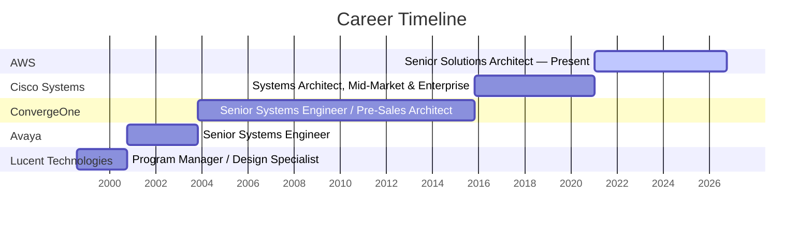

# Ray Elkins

**Cloud Architecture · Technical Product Strategy · Program Leadership · Agentic AI**

San Diego, CA · [rayelkins.com](https://rayelkins.com/) · [LinkedIn](https://www.linkedin.com/in/ray-elkins/) · [GitHub](https://github.com/rayelkins) · [elkinsrayo@gmail.com](mailto:elkinsrayo@gmail.com)

---

Senior Solutions Architect at AWS with enterprise technology experience, including AWS and Cisco, combining cloud architecture with technical product strategy and program leadership. Led a North America-wide security activation program that contributed to **$146M in influenced annual recurring revenue**. Translates customer discovery into product requirements, platform roadmaps, and technical solutions across cloud security and agentic AI. Built a hackathon-winning AI prototype using Amazon Bedrock and published open-source security audit tools in AWS's official samples repository. Holds an MBA from California State University San Marcos and four AWS professional and specialty certifications.

---

## Career Timeline

Dates shown at month-level precision. The ongoing AWS role is visualized through October 2026.

---

## Professional Experience

### Amazon Web Services (AWS) — San Diego, CA
**Senior Solutions Architect** · Jan 2021 – Present

- Own product strategy and operational execution for **AWS Security Activation Day**, a North America-wide customer engagement program serving **18,000+ attendees from 5,800+ unique customers annually**, directly contributing to **$146M in influenced ARR** and $53.9M in launched ARR across 2,593 qualified opportunities.
- Partner with AWS Security service teams to translate field insights and customer feedback into product decisions, including authoring a PRD for a new user attestation and auditing feature that enhanced customer visibility and compliance posture across identity workflows.
- Define program success metrics and KPIs including customer satisfaction (**sustained 4.67/5.0 across 191 events**), revenue attribution models, field participation rates, and time-to-productivity benchmarks for Solutions Architect onboarding.
- Apply deep technical acumen across mission-critical customer workloads including SAP migrations, data lake architectures, intelligent document processing, IoT platform modernizations, and high-performance computing, translating complex requirements into product-ready technical specifications.
- Conduct structured user research with Solutions Architects through the AWSome Builder program, synthesizing feedback into onboarding framework improvements and reusable enablement assets that reduced time-to-productivity across the field organization.
- Advise C-suite and senior technical stakeholders on cloud security, AI enablement, compliance alignment, and cost optimization, converting executive-level requirements into actionable technical direction and product priorities.
- Consistently recognized as an **"Exceeds High Bar"** performer and Leadership Principles Role Model, with peer and manager feedback citing strategic thinking, customer obsession, and readiness for expanded product leadership scope.

**Key Achievements**

- Won the AWS **"Be the Agentic Builder" Hackathon** (2025), outperforming 283 participants across 71 teams by defining and building a 0-to-1 agentic fleet management product using Amazon Bedrock, autonomous decision agents, and explainability guardrails, from customer problem identification through working prototype delivery.

**AWS Thought Leadership**

- Speaker, AWS re:Inforce (June 2023) and re:Invent (December 2022): presented threat detection platform capabilities to technical and executive audiences, translating complex security product concepts into business-outcome narratives.
- Awarded **Technical Field Community Contributor of the Year** (December 2023) for scaling technical content that accelerated product adoption and customer success across North America.
- Published two open-source security audit tools to the official [aws-samples](https://github.com/aws-samples) GitHub organization — see [Selected Projects](#selected-projects) below.
- Coauthored [Accelerating M&A due diligence with Amazon Bedrock AgentCore](https://aws.amazon.com/blogs/machine-learning/accelerating-ma-due-diligence-with-amazon-bedrock-agentcore/) on the AWS Machine Learning Blog.

---

### Cisco Systems — San Diego, CA
**Systems Architect, Mid-Market & Enterprise** · Nov 2015 – Jan 2021

- Served as a field product partner on the **Duo MFA post-acquisition tiger team**, collaborating directly with Product Management and Engineering to validate product-market fit, identify deployment friction, and shape go-to-market execution frameworks for a newly integrated security platform.
- Drove product adoption strategy for Cisco's newly acquired SaaS security portfolio, translating customer discovery insights from 35 Systems Architects across the Western region into deployment patterns and enablement content that contributed to **approximately 50% growth in security bookings within 3 quarters**.
- Synthesized field intelligence from enterprise customer engagement into actionable product feedback for Cisco Security product teams, identifying gaps in competitive positioning, feature readiness, and integration complexity during active post-acquisition integration cycles.
- Developed multi-year product roadmaps across networking, collaboration, data center, and security platforms for strategic enterprise accounts, balancing feature prioritization, technical debt trade-offs, scalability requirements, and customer business objectives.
- Provided technical product governance on complex enterprise engagements totaling **$15M+**, advising executive stakeholders on architectural trade-offs, integration sequencing, cost models, and long-term platform maintainability aligned to business growth priorities.

**Key Achievements**

- Systems Engineer of the Year (2019), Cloud Security Champion (2018), and Culture Award (2020).

---

### ConvergeOne (C1) — San Diego, CA
**Senior Systems Engineer / Pre-Sales Architect** · Nov 2003 – Nov 2015

- Owned a 10-year product lifecycle for a mission-critical unified communications platform serving **19,000+ users across 36 County of San Diego departments**, managing roadmap evolution, feature prioritization, stakeholder alignment, and technical governance across multiple budget and planning cycles.
- Conducted continuous customer discovery through site surveys, stakeholder interviews, and infrastructure assessments, translating complex operational requirements from diverse user personas across government departments into technical specifications and multi-phase deployment roadmaps.
- Governed end-to-end product delivery from initial requirements definition through systems design, technical standards, implementation handoff, and long-term platform evolution, maintaining architectural consistency and operational continuity across a geographically distributed environment.
- Served as the long-term strategic product advisor to county executive leadership, aligning platform decisions with operational priorities, compliance requirements, budget constraints, and multi-year scalability goals spanning multiple administrations.

<b>Earlier roles</b> (Avaya · Lucent Technologies)

### Avaya Inc. — San Diego, CA
**Senior Systems Engineer** · Oct 2000 – Nov 2003

- Served as voice-of-customer liaison between enterprise clients and Avaya product development teams, channeling field requirements into product roadmap feedback.

### Lucent Technologies — San Diego, CA
**Program Manager / Design Specialist** · Aug 1998 – Oct 2000

---

## Selected Projects

**[sample-secrets-manager-audit](https://github.com/aws-samples/sample-secrets-manager-audit)** — open-source security audit tool published to AWS's official [aws-samples](https://github.com/aws-samples) organization. Translates customer needs into a reusable tool for evaluating effective access to AWS Secrets Manager secrets.

**[sample-kms-access-audit](https://github.com/aws-samples/sample-kms-access-audit)** — open-source security audit tool published to AWS's official [aws-samples](https://github.com/aws-samples) organization. Translates field-validated customer needs into a reusable tool for evaluating effective access to AWS KMS keys.

**Agentic Fleet Management Prototype** — first-place winner of the AWS "Be the Agentic Builder" Hackathon (2025), out of 283 participants across 71 teams. A 0-to-1 prototype of an agentic fleet management product built with Amazon Bedrock, autonomous decision agents, and explainability guardrails — from customer problem identification through working prototype delivery.

**[Accelerating M&A Due Diligence with Amazon Bedrock AgentCore](https://aws.amazon.com/blogs/machine-learning/accelerating-ma-due-diligence-with-amazon-bedrock-agentcore/)** — coauthored AWS Machine Learning Blog article presenting a multi-agent architecture for enterprise due diligence with orchestration, retrieval, governance, memory, and citation-based validation.

---

## Core Competencies

| Area | Competencies |
|---|---|
| Product & Program | Data-Driven Decision Making · Product Strategy & Prioritization · Cross-Functional Alignment · Technical Product Roadmapping · Product Metrics & KPI Definition · Voice of the Customer · Go-to-Market & Field Enablement · Agile Product Development |
| Technical & Governance | Security & Compliance Architecture · Program Governance · Vendor & Platform Evaluation · Automation Development |

---

## Technical Proficiencies

| Area | Skills |
|---|---|
| Cloud & Infrastructure | AWS, Infrastructure as Code, Cloud Security Architecture |
| AI & Automation | Generative AI, Agentic AI Systems, Amazon Bedrock, AI Coding Agents |
| Security | Threat Detection, Identity and Access Management |
| Languages | Python |

---

## Education and Credentials

**Master of Business Administration (MBA)** — California State University San Marcos

**Bachelor of Science (BS) in Accounting** — San Diego State University, Fowler School of Business

**AWS Certifications**

- AWS Certified Solutions Architect – Professional
- AWS Certified Security – Specialty
- AWS Certified DevOps Engineer – Professional
- AWS Certified Advanced Networking – Specialty

---

<i>Always building. Always learning.</i>

